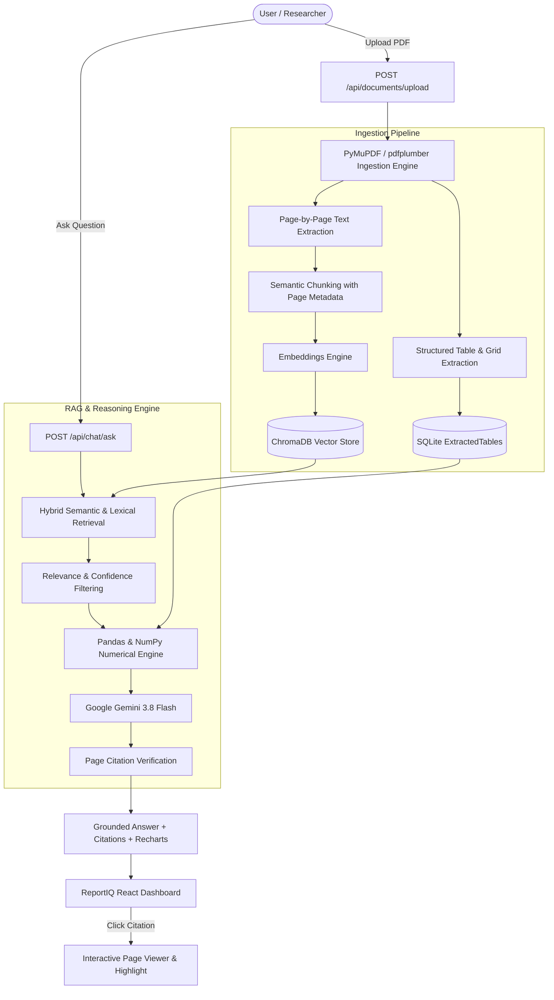

# ReportIQ – AI Government Statistics Navigator

> **Production-grade AI Document Intelligence Platform for Government Statistical Reports**  
> Grounded Retrieval-Augmented Generation (RAG) • Exact Page Citations • Programmatic Table Intelligence • Recharts Visualizations • Zero Fact Hallucination

---

## 1. Project Overview

**ReportIQ** is a full-stack document intelligence platform engineered specifically for large, complex government statistical publications (Census figures, Demographic surveys, Labor & Employment reports, Economic indices).

Unlike generic LLM wrappers that fabricate arithmetic and hallucinate page numbers, ReportIQ enforces **strict grounding**:
1. **Preserves 1:1 Page Mappings**: Every extracted text passage and structured table is permanently associated with its physical PDF page number.
2. **Deterministic Table Reasoning**: Questions requiring totals, rankings, averages, minimums/maximums, and percentage changes are computed programmatically using **Pandas and NumPy** rather than relying on LLM mental math.
3. **Interactive Verification**: Clicking any citation opens the exact PDF page in an embedded viewer and highlights the supporting excerpt.
4. **Resilient Architecture**: Supports live **Google Gemini 3.8 Flash** with an automatic offline deterministic fallback mode when API keys are absent.

---

## 2. System Architecture



---

## 3. Technology Stack

### Frontend
- **Framework**: React 18 with Vite & TypeScript
- **Styling**: Tailwind CSS (Custom Dark Navy & Charcoal Theme `#070A11`, `#0B0F19`, `#151F33`)
- **Icons**: Lucide React
- **Data Visualizations**: Recharts (Responsive Bar, Comparison, and Line charts)
- **Document Viewing**: Interactive PDF Page Navigator with page jump and zoom

### Backend
- **Framework**: Python 3.12, FastAPI, Pydantic v2, Uvicorn
- **Database**: SQLite with SQLAlchemy 2.0 (AsyncIO with aiosqlite)
- **Vector Database**: ChromaDB (with persistent local hybrid fallback)
- **Document Ingestion**: PyMuPDF (`fitz`), `pdfplumber`, `pypdf`, `reportlab`
- **Numerical Engine**: Pandas 2.3 & NumPy 2.2
- **LLM Reasoning**: Google GenAI SDK (`google-genai`) with `gemini-3.8-flash`

---

## 4. Key Capabilities & Features

### A. Grounded RAG with Exact Page Citations
Every answer produced includes structured citation metadata:
- **Source Document**: File name and ID
- **Page Reference**: Exact 1-indexed PDF page
- **Evidence Excerpt**: Verbatim passage or tabular cell data
- **Source Type**: `Text` or `Table`
- **Interactive Navigation**: Click any citation badge to view the rendered page in the viewer.

### B. Table Intelligence with Pandas & NumPy
When questions ask for numerical analysis:
- Identifies relevant tables in the database.
- Normalizes numeric columns (stripping commas, currency symbols, percentages).
- Executes calculations programmatically (`.sum()`, `.mean()`, `.idxmax()`, `.idxmin()`, `.sort_values()`, percentage change).
- Generates structured chart data for Recharts automatically.

### C. Hallucination Prevention
- Configurable **Retrieval Confidence Threshold** (default: 30%).
- If retrieved evidence is below threshold or lacks the answer, ReportIQ explicitly returns:
  `"Not found in the uploaded report. The uploaded document does not contain verified data regarding [topic]."`
- Never uses unverified outside knowledge.

---

## 5. Getting Started

### Prerequisites
- Python 3.12+
- Node.js 20+ and npm
- (Optional) Docker and Docker Compose

### Local Development Setup

#### 1. Clone & Configure Environment
```bash
git clone https://github.com/your-org/reportiq.git
cd reportiq

# Copy environment variables template
cp .env.example backend/.env
```

Edit `backend/.env` to add your Gemini API key (optional; if left blank, development mode runs deterministically):
```env
GEMINI_API_KEY=your_gemini_api_key_here
GEMINI_MODEL=gemini-3.8-flash
```

#### 2. Backend Setup
```bash
cd backend
python -m venv .venv

# On Windows:
.venv\Scripts\activate
# On Linux/macOS:
# source .venv/bin/activate

pip install -r requirements.txt

# Start FastAPI backend
uvicorn app.main:app --host 127.0.0.1 --port 8000 --reload
```
The backend API docs will be live at: `http://127.0.0.1:8000/docs`

#### 3. Frontend Setup
In a new terminal:
```bash
cd frontend
npm install
npm run dev
```
Open your browser at `http://localhost:3000`

---

## 6. Docker Deployment

Run both frontend and backend in isolated production containers using Docker Compose:

```bash
docker-compose up --build
```

- **Frontend Application**: `http://localhost:3000`
- **FastAPI Documentation**: `http://localhost:8000/docs`
- **Health Check**: `http://localhost:8000/api/health`

---

## 7. Sample Statistical Report & Verification

To generate a sample mock government report for testing:
```bash
python sample_data/create_sample_report.py
```
This creates `sample_data/sample_statistical_report.pdf` containing:
- **Page 1**: Executive demographic overview (Total Population: 1,380,004,385, Rural Percentage: 68.84%, Registered Workers: 472,190,000).
- **Page 2**: State-wise Literacy Rates table (Kerala: 94.00%, Mizoram: 91.33%, Bihar: 61.80%).
- **Page 3**: Labor Force Metrics table (Gujarat unemployment: 2.2%, Maharashtra workers: 49,427,000).
- **Page 4**: Decadal Census Growth comparison table (2011 vs 2021 percentage change).

Upload this report in the ReportIQ Dashboard and try asking:
1. *"Which state recorded the highest literacy rate?"* -> Kerala (94.00%) with bar chart and Page 2 citation.
2. *"What was the total population recorded in the report?"* -> 1,380,004,385 with Page 1 citation.
3. *"Which state has the lowest unemployment rate?"* -> Gujarat (2.2%) with Page 3 citation.
4. *"What was the percentage change between 2011 and 2021?"* -> Decadal growth table analysis with Page 4 citation.
5. *"What is the rainfall in Antarctica?"* -> Grounded refusal ("Not found in the uploaded report").

---

## 8. Automated Test Suite

ReportIQ includes an automated test suite verifying extraction, chunking, retrieval, arithmetic, and API endpoints:

```bash
# Run all tests
pytest tests -v
```

Test coverage includes:
- `test_pdf_processing.py`: Page count and 1:1 page number preservation.
- `test_numerical_engine.py`: Highest, lowest, ranking, and chart generation via Pandas.
- `test_rag_pipeline.py`: Grounded answers, exact citations, and missing information handling.
- `test_api_endpoints.py`: `/api/health`, `/api/documents`, `/api/chat/ask`, `/api/analytics/overview`.

---

## 9. API Reference

| Method | Endpoint | Description |
|---|---|---|
| `GET` | `/api/health` | Service health and telemetry status |
| `POST` | `/api/documents/upload` | Upload multi-page statistical PDF |
| `GET` | `/api/documents` | List all uploaded documents with metadata |
| `GET` | `/api/documents/{id}` | Get document details, pages, and extracted tables |
| `DELETE` | `/api/documents/{id}` | Delete document and delete vector embeddings |
| `GET` | `/api/documents/{id}/pages/{page}` | Fetch specific page text and tables |
| `GET` | `/api/documents/{id}/pdf` | Stream or download original PDF |
| `POST` | `/api/chat/ask` | Ask natural language question (RAG + Numerical Engine) |
| `GET` | `/api/chat/history` | List previous research conversations |
| `DELETE` | `/api/chat/history/{id}` | Delete conversation session |
| `POST` | `/api/search` | Hybrid, semantic, or keyword search across indexed chunks |
| `GET` | `/api/analytics/overview` | Platform telemetry and indexed domain stats |
| `POST` | `/api/settings/config` | Runtime AI model selection & Gemini API key configuration |

---

## 10. License

Developed for hackathons and government document research. Licensed under the MIT License.
